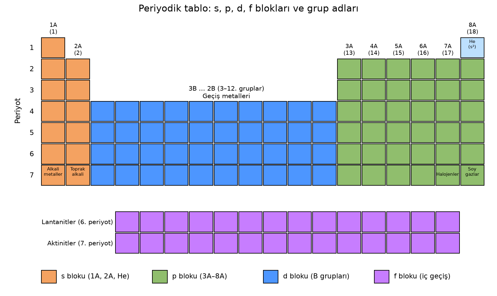
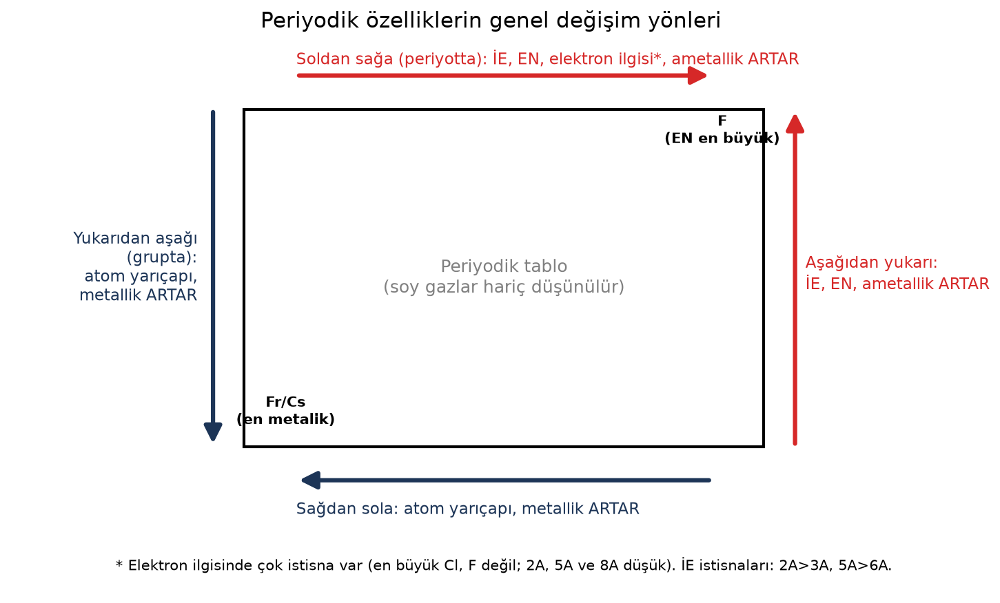
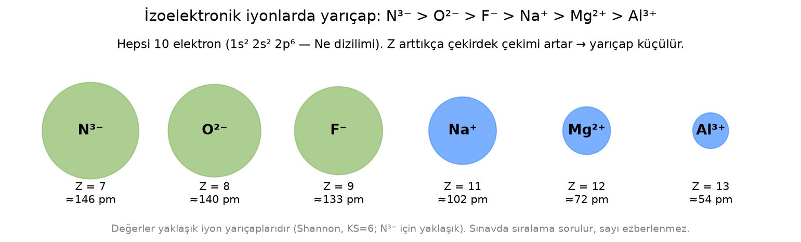
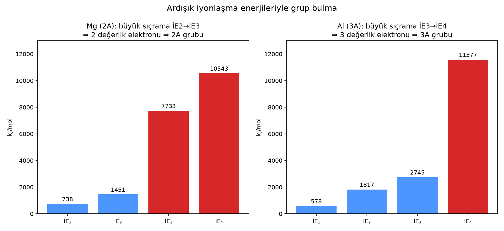

# Periyodik sistem ve periyodik özellikler

> **Kapsam etiketi:** **[TYT]** = 9. sınıf kazanımı (TYT'de sorulabilir) · **[AYT]** = 11. sınıf "Modern Atom Teorisi" kazanımı (AYT'de sorulabilir) · **[Müfredat dışı]** = ayrı bölümde.
>
> **Müfredat notu:** YKS'ye bugün hazırlanan 12. sınıf/mezun öğrencilerin büyük kısmı 9. sınıfı 2018 programıyla (9.2.3 Periyodik Sistem) okudu. 2024-2025'ten itibaren 9. sınıfta "Türkiye Yüzyılı Maarif Modeli" uygulanıyor (KİM.9.1.6–9.1.8). Farklar 1.3 bölümünde. Hangi programın hangi YKS yılına yansıyacağını ÖSYM'nin o yılki kılavuzundan kontrol et.

## 1. Müfredatta bu konu nerede?

### 1.1 TYT – 9. sınıf (2018 programı, 9.2.3 Periyodik Sistem)
- **9.2.3.1** Elementlerin periyodik sistemdeki yerleşim esasları: Mendeleyev'in çalışmaları ve Moseley'in katkısı; katman-elektron dağılımı ile yer bulma (**ilk 20 element esas**).
- **9.2.3.2** Elementlerin metal, ametal, yarı metal ve soy gaz olarak sınıflandırılması.
- **9.2.3.3** Periyodik özelliklerin değişim eğilimleri: metalik-ametalik, atom yarıçapı, iyonlaşma enerjisi, elektron ilgisi, elektronegatiflik. **Nasıl ölçüldüklerine ve kovalent/iyonik/metalik/van der Waals yarıçap tanımlarına girilmez.**

### 1.2 AYT – 11. sınıf (2018 programı, 11.1 Modern Atom Teorisi)
- **11.1.2.1** Nötr atomların elektron dizilimi (orbital gösterimi: Aufbau, Pauli, Hund) ile periyodik sistemdeki yer; değerlik orbitali/elektronu; blok → grup ve periyot (**Z ≤ 36**).
- **11.1.3.1** Periyodik özelliklerin değişimini **sebepleriyle** açıklama: kovalent, van der Waals ve iyonik yarıçap farkı; metallik/ametallik, atom/iyon yarıçapı, iyonlaşma enerjisi, elektron ilgisi, elektronegatiflik, **oksit/hidroksitlerin asitlik-bazlık eğilimi**; **ardışık iyonlaşma enerjileri ile grup numarası ilişkisi**. Ölçüm yöntemlerine girilmez.
- **11.1.4.1** s, p, d blok elementlerinin metal/ametal karakteri, iyon yükü, aktifliği, bağ tipi; f blokunun özel konumu; soy gaz özelliklerinin elektron dizilimiyle ilişkisi.

### 1.3 2024 Maarif modeli (9. sınıf) değişiklikleri
- Tema: **"Etkileşim" → "Atomdan Periyodik Tabloya"** bölümü. Öğrenme çıktıları: **KİM.9.1.6** (elektron dizilimi ile periyodik tablodaki yer arasında örüntü bulma, genelleme), **KİM.9.1.7** (iyon oluşumu), **KİM.9.1.8** (periyodik özellikleri etkileyen etmenler ve tablodaki değişim).
- Orbitaller ve elektron dizilimi artık **9. sınıfta** (KİM.9.1.4–9.1.5). Katman dağılımının **ilk 36 element** için uygulanabilirliği sorgulanır.
- Gruplar hem A/B hem IUPAC (1–18) numarasıyla verilir. **d ve f blokları (lantanit, aktinit)** ile **1A, 2A, 3A, 7A, 8A** gruplarının özel adları ve genel özellikleri işlenir.
- 9. sınıfta periyodik özellik olarak yalnızca **atom yarıçapı, iyonlaşma enerjisi ve elektronegatiflik** adı geçer. **Elektron ilgisi ve metallik/ametallik 9. sınıf içerik çerçevesinde açıkça yer almaz.** 11. sınıfın yeni programı için o yılın resmî metnine bakılmalıdır.

### 1.4 ÖSYM soru eğilimi
- **TYT:** Kimyadaki 7 sorunun içinde "Periyodik Sistem" 2018'den bu yana çoğu yıl **0–1 soru** ile yer alıyor. Kaynakların yıl yıl sayımı küçük farklar gösteriyor. Tipik soru tipleri: verilen elektron dizilimi/atom numarasıyla yer bulma, grup özellikleri, tablo üzerinde harflerle verilen elementlerin özelliklerini karşılaştırma.
- **AYT:** "Periyodik özellikler" tek başına seyrek çıkıyor. Ama Modern Atom Teorisi ünitesi hemen her yıl soruluyor ve periyodik özellikler sık sık bu sorulara bir öncül olarak ekleniyor. Tipik soru tipleri: ardışık iyonlaşma enerjisi tablosu, 2A/3A–5A/6A istisnaları, izoelektronik tanecik sıralaması.

## 2. Tarihçe [TYT]
| Bilim insanı | Yıl | Katkı |
|---|---|---|
| **Döbereiner** | 1817–1829 | **Üçlüler (triadlar):** Benzer özellikte üç elementten ortadakinin atom kütlesi, diğer ikisinin ortalamasına yakındır (Ca–Sr–Ba, Cl–Br–I, Li–Na–K). |
| **Newlands** | 1864–1865 | **Oktavlar kuralı:** Atom kütlesine göre dizilen elementlerde her sekizinci element birinciye benzer. Hafif elementlerde tuttu, ağırlarda bozuldu. |
| **Mendeleyev** | 1869 | Elementleri **artan atom kütlesine** ve kimyasal benzerliğe göre dizdi. Bulunmamış elementler için **boşluk bıraktı** ve bunların özelliklerini önceden tahmin etti: eka-alüminyum → Ga, eka-silisyum → Ge. Gerektiğinde benzerliği kütle sırasından üstün tuttu (Te–I). "Periyodik sistemin babası" olarak anılır. |
| **Lothar Meyer** | 1864/1870 | Mendeleyev'den bağımsız olarak benzer bir tablo hazırladı. **Fiziksel özelliklerin** (atom hacmi) atom kütlesiyle periyodik değiştiğini grafikle gösterdi. |
| **Moseley** | 1913 | X ışını çalışmalarıyla **atom numarasını** (proton sayısı) belirledi. Tablo **artan atom numarasına** göre düzenlendi. Mendeleyev tablosundaki Ar–K, Co–Ni, Te–I sıralama sorunları çözüldü. |

**Modern periyodik yasa:** Elementlerin fiziksel ve kimyasal özellikleri **atom numaralarının** periyodik bir fonksiyonudur.

## 3. Periyodik tablonun yapısı [TYT]
- **Periyot:** Yatay sıra. 7 periyot vardır. Periyot numarası, elektron bulunan **en yüksek katman (n)** sayısıdır. Periyotlardaki element sayıları sırasıyla 2, 8, 8, 18, 18, 32, 32'dir.
- **Grup:** Düşey sütun. 18 grup vardır: 8 A grubu (ana grup) + 10 B grubu (geçiş metalleri). IUPAC numaralandırması 1–18'dir (1A=1, 2A=2, 3B–2B=3–12, 3A=13 … 8A=18). 8B, üç sütunu (8, 9, 10) kapsar. Aynı gruptaki elementlerin **değerlik elektron sayısı aynıdır**, bu yüzden kimyasal özellikleri benzerdir. **He istisnadır:** 2 değerlik elektronu (1s²) olduğu hâlde 8A'dadır.
- **Bloklar [TYT/AYT]:** Elektronun en son girdiği orbital türü bloku belirler.
  - **s bloku:** 1A, 2A ve He
  - **p bloku:** 3A–8A
  - **d bloku:** B grupları (geçiş metalleri)
  - **f bloku:** lantanitler (6. periyot) ve aktinitler (7. periyot), yani iç geçiş elementleri. Tabloyu kısa tutmak için ana tablonun altında ayrı iki sıra olarak gösterilirler.

### 3.1 Grup adları ve genel özellikleri
- **1A – Alkali metaller** (Li, Na, K, Rb, Cs, Fr):
  - ns¹ dizilimine sahiptir, bileşiklerinde +1 yük alır.
  - En aktif metallerdir. Suyla tepkimeye girerek H₂ ve baz oluştururlar. Doğada serbest hâlde bulunmazlar.
  - Yumuşaktırlar ve erime noktaları düşüktür.
  - **H, 1A'da yer alır ama metal değil, ametaldir.**
- **2A – Toprak alkali metaller** (Be, Mg, Ca, Sr, Ba, Ra): ns² dizilimine sahiptir, +2 yük alırlar. Aktiftirler ama alkalilerden daha az aktiftirler.
- **3A – Toprak metalleri / bor grubu** (B, Al, Ga, In, Tl): B yarı metaldir. Al +3 yük alır ve oksiti amfoterdir.
- **7A – Halojenler** (F, Cl, Br, I, At):
  - ns²np⁵ dizilimine sahiptir. En aktif ametallerdir, metallerle −1 yük alırlar.
  - Doğada iki atomlu moleküller (X₂) hâlinde bulunurlar. Oda koşullarında F₂ ve Cl₂ gaz, Br₂ sıvı, I₂ katıdır.
- **8A – Soy (asal) gazlar** (He, Ne, Ar, Kr, Xe, Rn):
  - Değerlik katmanları doludur (He: 1s², diğerleri: ns²np⁶). Kararlıdırlar.
  - Tek atomlu gaz hâlinde bulunurlar. Normal koşullarda tepkimeye girmezler.
  - Kendi periyotlarında en büyük iyonlaşma enerjisi soy gazlarındır.
- **B grupları – Geçiş metalleri:** Hepsi metaldir. Çoğunlukla birden fazla pozitif değerlik alırlar (Fe²⁺/Fe³⁺, Cu⁺/Cu²⁺). Renkli bileşikler oluştururlar ve çoğu iyi katalizördür.
- **Lantanitler ve aktinitler:** f bloku (iç geçiş) elementleridir. Aktinitlerin hepsi radyoaktiftir.

### 3.2 Metal, ametal, yarı metal, soy gaz [TYT]
| Özellik | Metal | Ametal | Yarı metal |
|---|---|---|---|
| Fiziksel hâl (oda) | Hg dışında katı | Katı, sıvı (Br₂) veya gaz | Katı |
| Parlaklık | Parlak | Mat (I₂ parlakça) | Parlak |
| İletkenlik | İyi iletken (grafit hariç ametaller yalıtkan) | Yalıtkan | Yarı iletken |
| İşlenebilirlik | Dövülür, tel ve levha hâline gelir | Kırılgan | Kırılgan |
| Tepkimede | Elektron verir, + yük alır | Metallerle elektron alır, − yük alır | Ara davranış |
| Kendi arasında | Bileşik oluşturmaz, alaşım oluşturur | Kovalent bağlı bileşik oluşturur | — |

Yarı metaller: **B, Si, Ge, As, Sb, Te** (bazı kaynaklar Po ve At'ı da sayar). Tabloda B'den At'a uzanan basamak çizgisinin çevresinde yer alırlar.

## 4. Elektron dizilimiyle yer bulma
### 4.1 Katman dağılımıyla (A grupları) [TYT]
- **Katman sayısı = periyot**, **son katmandaki elektron sayısı = A grup numarası**.
- Örnek: ₁₁Na: 2) 8) 1) → 3. periyot, 1A. ₁₇Cl: 2) 8) 7) → 3. periyot, 7A. ₂₀Ca: 2) 8) 8) 2) → 4. periyot, 2A.
- 2018 programında ilk 20 element esastır. Z > 20 olan elementlerde katman dağılımı yanıltabilir: ₂₆Fe için 2-8-14-2 doğrudur ama "son katmanda 2 → 2A" çıkarımı yanlıştır.

### 4.2 Orbital dizilimiyle [AYT; Maarif'te 9. sınıf]
Önce Aufbau sırası: 1s 2s 2p 3s 3p 4s 3d 4p 5s …
- **Periyot** = en büyük baş kuantum sayısı (n).
- **s ile bitiyorsa:** grup = ns elektron sayısı (1A veya 2A).
- **p ile bitiyorsa:** grup = ns + np elektron sayısı (3A–8A).
- **d ile bitiyorsa:** ns + (n−1)d elektron sayısı toplanır:
  - 3 → 3B, 4 → 4B, 5 → 5B, 6 → 6B, 7 → 7B
  - 8, 9, 10 → 8B
  - 11 → 1B, 12 → 2B
- **Küresel simetri istisnaları:**
  - ₂₄Cr: [Ar] 4s¹ 3d⁵ → 4. periyot, 6B
  - ₂₉Cu: [Ar] 4s¹ 3d¹⁰ → 4. periyot, 1B
- **Örnekler:**
  - ₂₆Fe: [Ar] 4s² 3d⁶ → 2 + 6 = 8 → 8B, 4. periyot
  - ₃₀Zn: 4s² 3d¹⁰ → 2B
  - ₃₅Br: [Ar] 4s² 3d¹⁰ 4p⁵ → 2 + 5 = 7 → 7A, 4. periyot (d elektronları A grup numarasına katılmaz)

### 4.3 İyon oluşumu [TYT]
- Metaller değerlik elektronlarını vererek bir önceki soy gazın dizilimine ulaşır (Na⁺ ile Ne aynı dizilime sahiptir).
- Ametaller elektron alarak kendi periyodundaki soy gazın dizilimine ulaşır (Cl⁻ ile Ar aynı dizilime sahiptir).
- **[AYT]** Geçiş metallerinde iyon oluşurken elektron önce **en dış s orbitalinden** kopar: Fe²⁺ = [Ar] 3d⁶ (4s² 3d⁴ DEĞİL!).

## 5. Periyodik özellikler
Hepsinin ortak "nedeni" iki etkinin yarışıdır:
- **Katman sayısı:** Katman arttıkça elektron çekirdekten uzaklaşır ve iç elektronlar perdeleme yapar.
- **Etkin çekirdek yükü:** Aynı periyotta proton sayısı artar, perdeleme ise az değişir. Bu yüzden değerlik elektronlarına uygulanan net çekim artar.

### 5.1 Atom yarıçapı [TYT; yarıçap türleri AYT]
- **Grupta yukarıdan aşağı ARTAR.** Neden: Katman sayısı artar.
- **Periyotta soldan sağa genelde AZALIR.** Neden: Katman sayısı aynı kalırken proton sayısı ve etkin çekirdek yükü artar, elektronlar daha çok çekilir.
- Karşılaştırma kuralı: Önce katman sayısına bak (fazla olan büyüktür). Katman sayısı eşitse proton sayısına bak (az olan büyüktür).
- **[AYT] Yarıçap türleri:**
  - **Kovalent yarıçap:** Aynı tür iki atom arasındaki kovalent bağ uzunluğunun yarısıdır.
  - **Van der Waals yarıçapı:** Bağ yapmamış komşu iki atomun (molekülün) çekirdekleri arasındaki uzaklığın yarısıdır. Kovalent yarıçaptan **büyüktür**.
  - **İyonik yarıçap:** Örgüdeki iyonun yarıçapıdır.
  - Hidrojen için ders kitabındaki değerler: kovalent 0,37 Å, van der Waals 1,20 Å.
- Soy gazların yarıçapı van der Waals yarıçapı olarak verildiği için periyot karşılaştırmalarında genelde dışarıda tutulur.

### 5.2 İyon yarıçapı
- **Katyon < kendi nötr atomu:** Elektron kaybedilir, çoğu zaman bir katman tamamen boşalır ve elektron başına düşen çekim artar. Örnek: Na⁺ < Na.
- **Anyon > kendi nötr atomu:** Eklenen elektronlar birbirini iter, elektron başına düşen çekim azalır. Örnek: Cl⁻ > Cl.
- **Aynı element için:** Fe³⁺ < Fe²⁺ < Fe. Genel olarak: elektron sayısı arttıkça yarıçap artar.
- **İzoelektronik tanecikler** (elektron sayısı aynı olanlar): Proton sayısı büyük olan küçüktür.
  - N³⁻ > O²⁻ > F⁻ > (Ne) > Na⁺ > Mg²⁺ > Al³⁺ (hepsi 10 elektron)
  - S²⁻ > Cl⁻ > K⁺ > Ca²⁺ (hepsi 18 elektron)

### 5.3 İyonlaşma enerjisi (İE)
**Tanım [TYT]:** Gaz hâldeki bir atomdan en zayıf bağlı elektronu koparmak için gereken enerjidir: X(g) + İE₁ → X⁺(g) + e⁻. Bu süreç her zaman **endotermiktir**.
- **Grupta yukarıdan aşağı AZALIR.** Neden: Elektron çekirdekten uzaklaşır ve perdeleme artar.
- **Periyotta soldan sağa genelde ARTAR.** Neden: Etkin çekirdek yükü artar, yarıçap küçülür.
- Her periyotta en düşük İE 1A'da, en yüksek İE 8A'dadır.
- **İstisnalar [TYT/AYT]:**
  - **2A > 3A:** 3A'nın np¹ elektronu, daha yüksek enerjili p orbitalinden kolay kopar. 2A'nın ns² dizilimi ise tam doludur. Örnek: Be > B, Mg > Al.
  - **5A > 6A:** 5A'nın np³ dizilimi yarı dolu ve küresel simetriktir. 6A'nın np⁴ dizilimindeki eşleşmiş elektron, itme nedeniyle kolay kopar. Örnek: N > O, P > S.
  - 2. periyot sıralaması: **Li < B < Be < C < O < N < F < Ne**
  - 3. periyot sıralaması: **Na < Al < Mg < Si < S < P < Cl < Ar**
- **Ardışık iyonlaşma enerjileri [AYT]:**
  - Her zaman İE₁ < İE₂ < İE₃ … sırası geçerlidir. Elektron azaldıkça kalan elektronlar daha sıkı tutulur.
  - **Büyük sıçrama**, soy gaz dizilimine ulaşılmış bir iç katmandan elektron koparılmaya başlandığında görülür.
  - **Sıçramadan önceki İE sayısı = değerlik elektron sayısı = A grup numarası.**
  - Örnek, Mg (kJ/mol): 738 / 1451 / **7733** / 10543. Sıçrama İE₂'den İE₃'e geçerken → 2A.
  - Örnek, Al: 578 / 1817 / 2745 / **11577** → 3A.

### 5.4 Elektron ilgisi (Eİ)
**Tanım:** Gaz hâldeki nötr bir atomun bir elektron aldığında meydana gelen enerji değişimidir: X(g) + e⁻ → X⁻(g). Çoğu element için bu süreç **ekzotermiktir** (enerji açığa çıkar).
- **Genel eğilim:** Periyotta sağa doğru artar (soy gazlar hariç), grupta aşağı doğru genelde azalır. **Çok istisnası vardır.**
- **En büyük elektron ilgisi Cl'dedir (F değil!).** F çok küçük olduğu için gelen elektron, mevcut elektronlardan güçlü itme görür. Aynı durum O ile S arasında da vardır: S > O.
- 2A (ns²), 8A (dolu) ve 5A (np³ yarı dolu) elementlerinin elektron ilgisi düşüktür. Bazılarında, örneğin soy gazlarda ve Be'de, işlem endotermiktir.
- **[AYT]** İkinci elektron ilgisi (O⁻ + e⁻ → O²⁻) **endotermiktir**, çünkü negatif iyon gelen elektronu iter.
- Elektron ilgisi bir atomun **bağ dışı** (izole) özelliğidir; elektronegatiflikle karıştırma.

### 5.5 Elektronegatiflik (EN)
**Tanım:** Bir atomun **bir bağda**, bağ elektronlarını kendine çekme yeteneğidir. Birimsizdir (Pauling ölçeği).
- **Periyotta sağa doğru ARTAR, grupta aşağı doğru AZALIR.** Neden: Yarıçap küçüldükçe ve etkin çekirdek yükü arttıkça çekim artar.
- En büyük EN **F**'dedir (≈4,0). Sonra **O** (≈3,4) gelir. **N ≈ Cl ≈ 3,0–3,2** civarındadır. En küçük EN **Cs** ve **Fr**'dedir.
- Soy gazlar genelde bağ yapmadığı için EN değerlendirmesine katılmaz.
- **İki atom arasındaki EN farkı bağın türünü belirler:**
  - Fark yoksa: apolar kovalent bağ
  - Fark azsa: polar kovalent bağ
  - Fark büyükse: iyonik bağ
- Bağ uçları: **Kısmi negatif (δ⁻) uç, EN'si büyük olan atomdur.**

### 5.6 Metalik ve ametalik aktiflik
- **Metalik aktiflik:** Elektron verme eğilimidir. İE ne kadar düşükse metal o kadar aktiftir. **Grupta aşağı ARTAR, periyotta sola doğru ARTAR.** En aktif metaller Fr ve Cs'dir (Fr radyoaktif olduğu için pratikte Cs).
  - Örnek: K, Na'dan daha aktiftir. Na, Mg'den daha aktiftir.
- **Ametalik aktiflik:** Elektron alma eğilimidir. **Grupta yukarı ARTAR, periyotta sağa doğru ARTAR** (soy gazlar hariç). En aktif ametal F'dir.
  - Halojenlerde aktiflik sırası: F₂ > Cl₂ > Br₂ > I₂. Bu yüzden aktif olan halojen, daha az aktif olanı tuzundan açığa çıkarır: Cl₂ + 2KBr → 2KCl + Br₂.

### 5.7 Oksit ve hidroksitlerin asit-baz karakteri [AYT]
- **Metal oksitleri bazik:** Na₂O + H₂O → 2NaOH. Diğer örnekler: CaO, MgO.
- **Ametal oksitleri asidik:** SO₃ + H₂O → H₂SO₄. Diğer örnekler: CO₂, P₄O₁₀, N₂O₅.
- **Amfoter oksitler:** Hem asitle hem bazla tepkimeye girerler. Örnekler: **Al₂O₃, ZnO** (Al(OH)₃, Zn(OH)₂). Ayrıca BeO, SnO, PbO, Cr₂O₃.
- **Nötr oksitler:** Suyla, asitle ve bazla tepkimeye girmezler. Örnekler: **CO, NO, N₂O**.
- **Eğilim:** Periyotta soldan sağa bazik karakter azalır, asidik karakter artar. 3. periyot için: Na₂O, MgO (bazik) → Al₂O₃ (amfoter) → SiO₂, P₄O₁₀, SO₃, Cl₂O₇ (asidik). Grupta aşağı doğru oksitlerin bazik karakteri artar.
- Aynı elementte yükseltgenme basamağı arttıkça oksitin asitliği artar. Örnek: CrO bazik, Cr₂O₃ amfoter, CrO₃ asidik.

### 5.8 Erime ve kaynama noktası eğilimleri (bkz. Müfredat dışı notu)
Bu özellik, tanecikler arası etkileşimlere bağlıdır. Bu yüzden "tek yön" kuralı yoktur.
- **1A metallerinde:** Grupta aşağı doğru erime noktası azalır. Neden: Metalik bağ, yarıçap büyüdükçe zayıflar. Örnek: Li > Na > K.
- **7A ve 8A'da (moleküler ve atomik yapılar):** Grupta aşağı doğru artar. Neden: Elektron sayısı arttıkça London kuvvetleri büyür. Örnek: F₂ < Cl₂ < Br₂ < I₂, He < Ne < Ar.
- **3. periyotta:** Si'ye kadar artar. Si kovalent ağ örgülü yapısı sayesinde en yüksek değerdedir. Sonra P₄, S₈, Cl₂ ve Ar ile düşer.

## 6. s, p, d, f blok özellikleri [AYT – 11.1.4.1]
- **s bloku:** H ve He dışında hepsi metaldir. Aktiftirler. Sabit yük alırlar (1A: +1, 2A: +2). Ametallerle çoğunlukla iyonik bileşik oluştururlar. Be bileşikleri kovalent karakterlidir.
- **p bloku:** Metal, yarı metal, ametal ve soy gazların hepsini içerir. Ametaller birbiriyle kovalent bağ yapar, metallerle iyonik bileşik oluşturur. Ametallerin negatif ve pozitif değerlikleri olabilir. Örnek: Cl −1 ile +7 arasında değerlik alabilir.
- **d bloku:** Hepsi metaldir. Değişken pozitif değerlik alırlar, renkli iyonlar oluştururlar. Çoğu katalizördür ve sert yapılıdır. Erime noktaları genelde yüksektir. Hg sıvıdır.
- **f bloku:** Lantanitlerin kimyasal özellikleri birbirine çok benzer. Aktinitler radyoaktiftir ve çoğu yapaydır. Tablo kısa tutulsun diye ana tablonun altında gösterilirler.
- **Soy gazlar:** Dolu değerlik katmanları nedeniyle kararlıdırlar ve İE'leri yüksektir. Tek atomlu olarak bulunurlar.

## 7. Sık yapılan hatalar / karıştırılanlar
1. **Elektron ilgisi ≠ elektronegatiflik.** Eİ izole atomun elektron almasındaki enerji değişimidir. EN ise bağdaki çekme yeteneğidir. En büyük Eİ **Cl**'de, en büyük EN **F**'dedir.
2. "İE periyotta hep artar" diye düşünmek yanlış: **2A > 3A** ve **5A > 6A** istisnalarını unutma.
3. "Atom numarası büyük olan atom büyüktür" diye genellemek yanlış. Periyotta tam tersi geçerlidir: Atom numarası arttıkça yarıçap küçülür.
4. İzoelektronik taneciklerde "yükü büyük olan büyüktür" demek yanlış. Doğrusu: **Proton sayısı az olan büyüktür.**
5. **He'yi 2A sanmak:** Değerlik elektronu 2 olsa da 8A'dadır. **H'yi metal sanmak:** 1A'dadır ama ametaldir.
6. Katman dağılımını Z > 20 olan elementlere uygulayıp B grubu elementine A grubu demek (Fe'yi 2A sanmak).
7. Geçiş metali iyonlaşırken elektronu 3d'den koparmak. Elektron **önce 4s**'den kopar.
8. Ardışık İE'de "en büyük değer"i aramak. Bakman gereken **oranca en büyük sıçramadır**.
9. Soy gazları elektronegatiflik ve ametalik aktiflik sıralamasına katmak.
10. CO ve NO'yu asidik oksit sanmak. İkisi de **nötr** oksittir. Al₂O₃ ve ZnO ise **amfoter**dir.
11. Mendeleyev'in tabloyu **atom kütlesine**, Moseley'in **atom numarasına** göre düzenlediğini karıştırmak.
12. Br'nin d elektronlarını grup numarasına katıp "17. grup" yerine "17B" demek. p ile biten elementler her zaman A grubundadır.

## 8. Müfredat dışı, bilgi amaçlı
- **Slater kuralları ile etkin çekirdek yükü hesabı:** Sınavda çıkma ihtimali çok düşük. Kavram olarak "etkin çekirdek yükü artar" demen yeterli.
- **Lantanit büzülmesi** (5. ve 6. periyot geçiş metallerinin yarıçaplarının birbirine çok yakın olması): Çok düşük.
- **Mulliken ve Allred-Rochow elektronegatiflik ölçekleri, periyodik özelliklerin ölçüm yöntemleri:** Çok düşük. Programda "ölçüme girilmez" diye açıkça yazar.
- **Diyagonal benzerlik** (Li–Mg, Be–Al, B–Si): Düşük. Be–Al amfoterliği bir öncülde dolaylı olarak geçebilir.
- **Erime ve kaynama noktasının periyodik eğilimi** (bkz. 5.8): Düşük–orta. Bir kazanım olarak doğrudan geçmez. Ama TYT "Kimyasal türler arası etkileşimler" konusu (London kuvvetleri, metalik bağ) üzerinden halojen ve soy gaz sıralaması sorulabilir.
- **Z = 36'dan büyük elementlerin orbital dizilimi** ve 4d, 5d istisnaları (Mo, Ag, Au…): Çok düşük.
- **Ametal oksitlerin anhidrit isimlendirmesi, peroksit ve süperoksitler:** Düşük.
- **Ardışık İE'deki ikinci sıçrama** (katmanlar arası ince yapı) **ve elektron ilgisinin sayısal değerleri:** Düşük. Sıralama sorulur, sayıların ezberlenmesi beklenmez.
- **Yeni element adları (Nh, Mc, Ts, Og) ve 118 elementin tamamlanması:** Düşük. Kültür bilgisi olarak kalır.

## 9. Örnek sorular (YKS tarzı)

### Soru 1 [TYT]
₁₂X, ₁₇Y ve ₁₉Z atomları için aşağıdakilerden hangisi yanlıştır?
A) X, 3. periyot 2A grubundadır.  B) Y halojendir.  C) Z'nin atom yarıçapı en büyüktür.  D) X ile Y, XY₂ bileşiğini oluşturur.  E) Y'nin birinci iyonlaşma enerjisi Z'ninkinden küçüktür.

**Çözüm:**
1. Katman dağılımları: X: 2-8-2 (3. periyot, 2A); Y: 2-8-7 (3. periyot, 7A, halojen); Z: 2-8-8-1 (4. periyot, 1A).
2. Z 4 katmanlıdır, bu yüzden yarıçapı en büyüktür. C doğrudur.
3. X²⁺ ve Y⁻ iyonlarından XY₂ oluşur. D doğrudur.
4. Y bir ametal (7A), Z bir alkali metaldir. Ametalin İE'si büyüktür, yani İE(Y) > İE(Z). E yanlıştır.

**Cevap: E**

### Soru 2 [TYT]
Mendeleyev ve Moseley ile ilgili hangisi doğrudur?
I. Mendeleyev elementleri artan atom kütlesine göre dizmiştir.
II. Mendeleyev bulunmamış bazı elementlerin özelliklerini önceden tahmin etmiştir.
III. Moseley, tablonun artan atom numarasına göre düzenlenmesini sağlamıştır.

**Çözüm:**
1. Mendeleyev, atom kütlesine ve kimyasal benzerliğe göre sıralama yaptı. I doğrudur.
2. Boşluklar bıraktı, Ga ve Ge'nin özelliklerini önceden söyledi. II doğrudur.
3. Moseley X ışını çalışmalarıyla atom numarasını belirledi. III doğrudur.

**Cevap: I, II ve III**

### Soru 3 [TYT/AYT]
N, O ve F'nin birinci iyonlaşma enerjilerinin sıralaması nedir?

**Çözüm:**
1. Üçü de 2. periyottadır. Periyotta genel eğilim artış yönündedir, bu yüzden F en büyüktür.
2. N 5A grubundadır (2p³, yarı dolu, küresel simetrik). O 6A grubundadır (2p⁴, eşleşmiş elektron itme görür). İstisna gereği N > O olur.

**Cevap: F > N > O**

### Soru 4 [AYT]
3. periyottaki bir X elementinin ardışık iyonlaşma enerjileri (kJ/mol): 578, 1817, 2745, 11577. X ile ilgili ne söylenebilir?

**Çözüm:**
1. Ardışık oranlara bak: 1817/578 ≈ 3,1; 2745/1817 ≈ 1,5; 11577/2745 ≈ 4,2.
2. En büyük sıçrama İE₃'ten İE₄'e geçerken görülüyor. Demek ki 3 değerlik elektronu vardır: 3A.
3. 3. periyot ve 3A grubunda olan element Al'dir. Değerliği +3'tür, oksiti Al₂O₃ ise amfoterdir.

**Cevap: Al (3A); oksiti amfoterdir.**

### Soru 5 [AYT]
S²⁻, Cl⁻, K⁺ ve Ca²⁺ iyonlarını yarıçaplarına göre büyükten küçüğe sırala.

**Çözüm:**
1. Elektron sayıları: S²⁻ (16 + 2 = 18), Cl⁻ (17 + 1 = 18), K⁺ (19 − 1 = 18), Ca²⁺ (20 − 2 = 18). Hepsi izoelektroniktir.
2. Elektron sayısı eşit olduğu için yarıçapı proton sayısı belirler: Proton sayısı arttıkça çekim artar, yarıçap küçülür.

**Cevap: S²⁻ > Cl⁻ > K⁺ > Ca²⁺**

### Soru 6 [AYT]
₂₄Cr ve ₂₉Cu için hangisi doğrudur?
I. İkisi de 4. periyottadır.  II. Cr 6B, Cu 1B grubundadır.  III. Cu⁺ iyonunun dizilimi [Ar] 3d¹⁰'dur.

**Çözüm:**
1. Cr: [Ar] 4s¹ 3d⁵ (küresel simetri istisnası). Periyodu 4'tür; 1 + 5 = 6 olduğu için 6B'dir.
2. Cu: [Ar] 4s¹ 3d¹⁰. Periyodu 4'tür; 1 + 10 = 11 olduğu için 1B'dir.
3. Cu⁺ oluşurken elektron 4s'den kopar, geriye [Ar] 3d¹⁰ kalır.

**Cevap: I, II ve III**

### Soru 7 [AYT]
Na₂O, Al₂O₃, SO₃ ve CO oksitlerini sınıflandır.

**Çözüm:**
1. Na₂O bir metal oksitidir, suyla NaOH oluşturur: bazik.
2. Al₂O₃ hem asitle hem bazla tepkimeye girer: amfoter.
3. SO₃ suyla H₂SO₄ oluşturur: asidik.
4. CO suyla, asitle ve bazla tepkimeye girmez: nötr.

**Cevap: Bazik, amfoter, asidik, nötr (sırasıyla)**

### Soru 8 [TYT]
Aynı periyotta bulunan 1A grubundaki X ile 7A grubundaki Y için hangisi yanlıştır?
A) Atom yarıçapı X > Y  B) Elektronegatiflik Y > X  C) X metal, Y ametaldir  D) Birinci İE X > Y  E) X ile Y iyonik bağlı XY oluşturur

**Çözüm:**
1. Periyotta sağa doğru yarıçap azalır, EN ve İE artar. A ve B doğrudur.
2. 1A elementi alkali metal, 7A elementi halojendir. C doğrudur.
3. İE periyotta sağa doğru arttığına göre İE(Y) > İE(X) olmalı. D yanlıştır.
4. X⁺ ve Y⁻ iyonlarından iyonik XY oluşur. E doğrudur.

**Cevap: D**

## 10. Kaynaklar
- MEB Talim ve Terbiye Kurulu, Ortaöğretim Kimya Dersi Öğretim Programı (2018): https://mufredat.meb.gov.tr/Dosyalar/201812102955190-19.01.2018%20Kimya%20Dersi%20%C3%96%C4%9Fretim%20Program%C4%B1.pdf
- Türkiye Yüzyılı Maarif Modeli Kimya Programı (2024): https://tymm.meb.gov.tr/upload/program/2024programkim9101112Onayli.pdf , https://tymm.meb.gov.tr/kimya-dersi/unite/92?kod=D12.1
- MEB ODSGM 9. sınıf kimya kazanımları: https://odsgm.meb.gov.tr/www/9-sinif-kimya/icerik/1282
- MEB 11. sınıf Kimya ders kitabı (EBA), 1.3 ve 1.4 bölümleri: https://ogmmateryal.eba.gov.tr/panel/upload/etkilesimli/kitap/kimya/11/unite1/files/basic-html/page27.html
- Soru dağılımları: https://reyhanlisfkasml.meb.k12.tr/meb_iys_dosyalar/31/08/963209/dosyalar/2025_12/694bcadab4eec921652162_2025TYT_Y%C4%B1llara_Gore_Soru_Dag%C4%B1l%C4%B1m%C4%B1.pdf , https://hayaihl.meb.k12.tr/meb_iys_dosyalar/46/01/745835/dosyalar/2023_10/01143716_AYT-Kimya-Soru-Dagilimi.pdf , https://kimya.gen.tr/analiz
